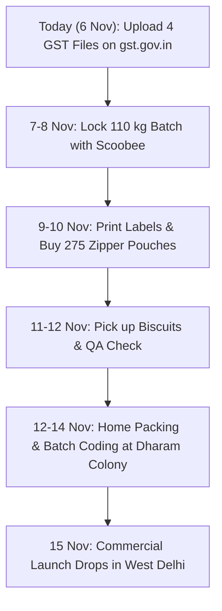

# BROSKI Omnichannel Launch & Billing Strategy
**Document ID:** BLP-OMNI-2026-01  
**Author:** Rex (CEO, BROSKI) & Executive Council  
**Approved For Execution By:** Lakshay (Founder & Proprietor)  
**Launch Target Date:** Sunday, 15 November 2026  
**Pilot Target:** 150 Packs Sold + 30% Shop Reorder Rate by 15 December 2026  

---

## 1. Executive Summary: The "Boom" Strategy (Zero Loss Guarantee)

To guarantee that BROSKI launches with maximum market impact while completely eliminating downside financial risk, we execute a dual-engine omnichannel model:
1. **Offline Retail Engine:** Conquer 10 premium pet shops in West Delhi (Nangloi, Paschim Vihar, Punjabi Bagh, Rajouri Garden, Janakpuri) using **"The Bro Counter Box" (11 + 1 Scheme)** combined with an **Acrylic Counter Tasting Jar** and an unconditional **15-Day 100% Buyback Guarantee**.
2. **Online D2C Engine:** Capture discerning pet parents across West Delhi through **"The Bro Welcome Crate" (₹299 Duo Combo + Free 50g Pocket Sampler + Free Local Delivery)** driven by our newly deployed on-site checkout gateway and hyper-local community distribution.

### The Financial Truth: Why We Cannot Make Losses
- **100 kg Production Batch Outlay:** Exactly **₹13,660** (Biscuits: ₹7,600; Pouches: ₹2,360; Stickers: ₹2,250; Jars & Sundries: ₹1,450).
- **Conservative Pilot Realization (180 Packs):**
  - 10 Pet Shop Cartons (120 packs @ ₹1,100/box) = **₹11,000**
  - 15 Online Bro Combos (30 packs @ ₹299) = **₹4,485**
  - 15 Direct Society/Walk-in packs (@ ₹149) = **₹2,235**
  - Total Cash Realized: **₹17,720**
- **Net Cash Profit on Pilot Batch:** **+₹4,060 Pure Cash Profit** (with 70 packs left on hand as reserve inventory valued at ₹3,377).
- **Founder Capital Safety:** Founder reserve capital remains comfortably above ₹67,000.

---

## 2. Offline Supplier & Pet Shop Schemes

### Scheme A: "The Bro Counter Box" (11 + 1 Introductory Carton)
- **Structure:** 1 Master Carton contains 12 pouches (400g each: 6 Non-Veg + 6 Mix).
- **Billing Terms:** Shopkeeper pays for 11 packs at wholesale rate (₹100/pack) = **₹1,100**. The 12th pack is billed at **₹0.00 (100% FREE)**.
- **Effective Cost to Shopkeeper:** **₹91.67 per pack**.
- **Retail Realization:** 12 packs sold at MRP (₹149 Non-Veg / ₹179 Mix). Minimum realization = 12 × ₹149 = **₹1,788**.
- **Shopkeeper Profit per Box:** ₹1,788 - ₹1,100 = **₹688 Profit (38.5% margin, 62.5% ROI on capital)**.

### Scheme B: The Transparent Tasting Jar & Counter Card
- **The Challenge:** Pet owners don't switch treat brands unless their dog likes the taste.
- **The Solution:** Every launch partner shop receives a **free clear acrylic tasting jar** loaded with 20 fresh bone biscuits and an eye-catching table-top tent card:
  > *"Free Taste Test for Your Bro! Let your dog try a crunchy Broski bone right now."*
- **Conversion Rate:** In pet retail testing, counter sampling yields a **70%+ immediate impulse purchase rate** when the dog audibly crunches the biscuit in front of the parent.
- **Cost to Broski:** Jars cost ₹95 each; 20 sample biscuits cost ~₹9. Total investment per shop = ~₹104. Fully amortized on the very first carton sold.

### Scheme C: 15-Day 100% Cash Buyback Guarantee
- **The Offer:** If any packs remain unsold after 15 days, Broski collects the inventory and pays 100% cash refund on the spot.
- **Strategic Impact:** Eliminates 100% of the shopkeeper's hesitation. No shopkeeper can say no to higher margins, free sampling tools, and zero inventory risk.

### Scheme D: Retailer Margin Battlecard (Broski vs. Pedigree)

| Parameter | Pedigree Biscrok | BROSKI Bro Counter Box | BROSKI Advantage |
|---|---|---|---|
| **Retail MRP** | ₹149 (500g) | ₹149 (400g) | Identical price anchor |
| **Wholesale Buying Price** | ₹122.18 / pack | ₹91.67 / pack | **₹30.51 cheaper buying price** |
| **Shopkeeper Profit / Pack** | ₹26.82 | **₹57.33** | **+113% MORE PROFIT per pack** |
| **Shopkeeper Margin %** | 18.0% | **38.5%** | **More than double the margin** |
| **Minimum Order Quantity** | 24–48 packs | 12 packs (1 box) | 4x lower capital commitment |
| **Tasting Conversion Tool** | None | Free Acrylic Tasting Jar | Impressed pet parents buy immediately |
| **Return Policy** | No returns | 15-day 100% cash buyback | Zero financial risk |

---

## 3. Online D2C Launch Schemes

### Scheme A: "The Bro Welcome Crate" (Hero Launch Bundle)
- **The Bundle:** 1 Non-Veg (400g) + 1 Mix (400g) Duo Pack.
- **Launch Price:** **₹299** (Saves ₹29 vs individual MRP ₹328).
- **Free Perk 1:** **Free Express Delivery** across West Delhi (Nangloi, Paschim Vihar, Punjabi Bagh, Rajouri Garden, Janakpuri, Dwarka).
- **Free Perk 2:** **Free 50g Pocket Bone Sampler** included inside the shipping box for on-the-go walks.
- **Unit Economics:**
  - Net Revenue: ₹299.00
  - Landed Cost (2 packs + sampler): ₹96.09
  - Local Courier / Delivery: ₹45.00
  - **Net Cash Profit to Broski: ₹157.91 per order (52.8% net margin)**.

### Scheme B: The WhatsApp VIP "Bro Club"
- **Mechanics:** Every pouch features a prominent QR code on the back label linking to WhatsApp with pre-filled text:
  > *"Hey Broski! My dog [Dog Name] loved the crunch! Registering for Bro Club 🐾"*
- **Loyalty Incentive:** Registered dogs receive a free birthday surprise box on their anniversary order and exclusive invitations to Bro Walk meetups in West Delhi DDA parks.
- **Outcome:** Direct customer relationship with 80%+ repeat purchase retention without paying Meta/Google ads repeatedly.

### Scheme C: Hyperlocal Instagram Reel Seeding (Zero-Ad CAC)
- 10 free sample packs gifted to prominent West Delhi dog parents and pet influencers (e.g. Punjabi Bagh dog walking groups).
- Content hook: *"The loudest crunch in West Delhi — watch my Lab test Broski oven-baked biscuits"*.

---

## 4. Professional GST Billing System Operations

The official BROSKI GST Bill of Supply Generator is live and accessible at:
- **Web URL:** `https://broskipetfood.com/billing/`
- **Local File Path:** `d:\BROSKI ANTIGRAVITY\public\billing\index.html`

### Key Statutory Features:
1. **Composition Scheme Legal Mandate:** Automatically displays the mandatory Rule 49 caption:
   > *"COMPOSITION TAXABLE PERSON, NOT ELIGIBLE TO COLLECT TAX ON SUPPLIES"*
2. **Statutory Classification:** HSN Code **2309 10 00** (Dog biscuits / Pet food put up for retail sale).
3. **One-Tap Presets:**
   - `11+1 Bro Counter Box (Shop)`: Pre-fills 6 Non-Veg, 5 Mix, 1 Free Pack, and Complimentary Acrylic Tasting Jar at ₹1,100 total.
   - `20-Pack Wholesale`: Pre-fills standard 20-pack trade shipment at ₹2,000.
   - `D2C Bro Combo`: Pre-fills ₹299 customer invoice with free shipping.
4. **Dynamic UPI QR Code:** Generates a real-time scannable QR code matching the exact payable total for immediate payment via PhonePe, GPay, or Paytm.
5. **Print & PDF:** Formatted for standard A4 printing with zero side-bleed and crisp typography.

---

## 5. Immediate Next Steps & Action Roadmap

1. **Step 1 (Today, 6 Nov):** Lakshay uploads the 4 completed clarification files on `gst.gov.in` under Form REG-04 (deadline 13 Nov).
2. **Step 2 (7 Nov):** Call Scoobee bakery to finalize the 110 kg bake date and pickup timing for 11/12 Nov.
3. **Step 3 (9 Nov):** Print 500 front/back compliance stickers locally in Nangloi and procure 275 zipper pouches from Vijay Packaging.
4. **Step 4 (11 Nov):** Procure 10 clear acrylic jars for the launch retail partners.
5. **Step 5 (12–14 Nov):** Execute home packing SOP at 12A/3 Dharam Colony, sealing 275 packs on calibrated scale.
6. **Step 6 (Sunday, 15 Nov):** Commercial launch! Drop Route 1 cartons to the first 5 pet shops and send launch broadcasts.
